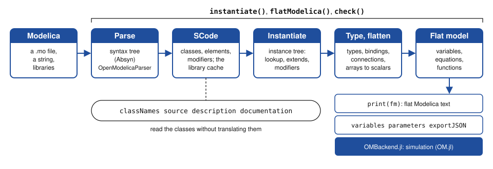

```@meta
CurrentModule = OMFrontend
```

# OMFrontend.jl

`OMFrontend` is the Julia port of the OpenModelica frontend. It parses Modelica
source, lowers it through SCode, and produces the flat model
(`FLAT_MODEL`, printable as flat Modelica) consumed by [OMBackend.jl](https://github.com/OpenModelica/OMBackend.jl)
and the wider [OM.jl](https://github.com/OpenModelica/OM.jl) toolchain.

## How OMFrontend works



OMFrontend translates a Modelica class into a flat model: one list of variables and one of equations, with the
component hierarchy, inheritance, modifiers and connections resolved. It does this in five steps.

1. **Parse.** [OpenModelicaParser.jl](https://github.com/OpenModelica/OpenModelicaParser.jl) reads the Modelica text
   (a file, a string, a library) into a syntax tree (`OpenModelicaParser.Absyn`).
2. **SCode.** The syntax tree becomes SCode (`OMFrontend.SCode`): classes, their elements and modifiers, in a
   simpler form. Libraries are kept in this form in a cache, so the Modelica Standard Library is parsed once.
3. **Instantiate.** The class is expanded into a tree of instances: names are looked up, `extends` clauses are
   merged, and modifiers are applied to the components they change.
4. **Type and flatten.** Every expression gets its type and dimensions, structural parameters are evaluated,
   `connect` equations become equality and sum-to-zero equations, and arrays are expanded into scalars.
5. **Flat model.** The result is a `FLAT_MODEL` with the functions it calls. It prints as flat Modelica,
   [OMBackend.jl](https://github.com/OpenModelica/OMBackend.jl) turns it into a simulation, and `check` counts its
   equations and variables.

`instantiate` runs all five steps. `classNames`, `source`, `description` and `documentation` read the classes after
step 2 without translating them.

## Installation

OMFrontend lives in the `OpenModelicaRegistry`. Add the registry once, then
install the package:

```julia
using Pkg
Pkg.Registry.add("General")
Pkg.Registry.add(Pkg.RegistrySpec(url = "https://github.com/OpenModelica/OpenModelicaRegistry.git"))
Pkg.add("OMFrontend")
```

## Quick example

```julia
using OMFrontend

fm = OMFrontend.instantiate("MyModel"; file = "MyModel.mo")
print(fm)        # flat Modelica
```

See [Getting started](@ref) for a longer walk-through and the
[API reference](@ref) for the full list of public entry points.

## Project layout

| Path                 | Purpose                                        |
|:---------------------|:-----------------------------------------------|
| `src/OMFrontend.jl`        | The module `OMFrontend`: the public API.             |
| `src/Frontend/`            | The module `Frontend` (`Frontend.jl`): instantiation, typing, flattening.     |
| `src/SCode/`               | SCode, Absyn -> SCode lowering, SCode helpers.       |
| `src/Absyn/`               | Absyn helpers and traversals.                        |
| `src/Util/`                | Flags, errors, hash maps, AVL trees, macros.         |
| `src/API/`                 | GUI API, component graphics, command line, display.  |
| `src/Precompilation/`      | The precompile workload and statements.              |

## Index

```@index
```
